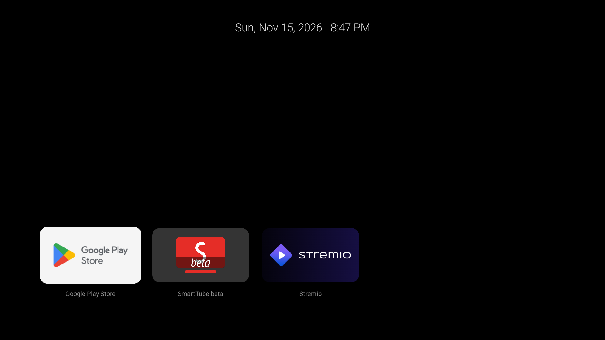

# BlackOut Launcher

A tiny, pure-black home screen for Google TV / Android TV, made for OLED TVs, plus a guide to safely debloating your TV with [Claude Code](https://claude.com/claude-code).



- **Pure black `#000000` background**: OLED pixels stay off.
- **Date and time** centered at the top. They're display-only and can't be selected.
- **Your apps in one row**: no ads, recommendations or rows of content.
- **No animations, highlights or glow**: the focused app's icon just gets 5% bigger, instantly.
- **Optional picture screensaver**: one image, fitted whole on black. With no image, it's plain black.
- **16 KB app**, about 55 MB of memory, compared with 130–150 MB for the launcher it replaced.

The app's internal package ID is `dev.blackhome.launcher` (from its first name, Black Home); you'll see it in the ADB commands below.

> **Want to debloat your TV too?** See **[DEBLOAT.md](DEBLOAT.md)** for the step-by-step guide, the exact package list and how to undo everything.

---

## Which TVs does this work on?

Both the launcher and the debloat guide need **Android**, with ADB debugging available in Developer options.

| TV / device | Launcher | Debloat guide |
|---|---|---|
| **Google TV** (Android 9+), e.g. Sony Bravia, TCL, Hisense, Sansui and Philips Google TV models, Chromecast with Google TV, Google TV Streamer | ✅ **Works.** Tested on a Sansui 4K Google TV (Android 14). Other models should work but are untested. | ✅ Works. Package names differ by brand, so check your own list first. |
| **Android TV** with the older home screen (not the Google TV interface), e.g. Nvidia Shield, older Sony/Philips/Sharp sets, Xiaomi Mi Box | ⚠️ **Not yet.** It installs, but the Home button still goes to the old home screen, because the redirect only watches Google TV's launcher. | ✅ Works. Same rules; package names differ. |
| **Amazon Fire TV** (Fire OS) | ❌ No. Fire OS blocks replacing its home screen. | ⚠️ Partly. ADB works, but the packages are Amazon's and aren't covered by this guide. |
| **LG** (webOS) | ❌ No | ❌ No |
| **Samsung** (Tizen) | ❌ No | ❌ No |
| **Roku TV** | ❌ No | ❌ No |
| **Hisense / Toshiba VIDAA**, **Vizio SmartCast**, **Panasonic** (My Home Screen) | ❌ No | ❌ No |
| **Apple TV** (tvOS) | ❌ No | ❌ No |

**Don't know which you have?** If your TV has the **Google Play Store**, it's Google TV or Android TV. On Google TV, the home screen has tabs along the top ("For you", "Movies", "Shows" and so on), and Settings says "Google TV".

---

## How the Home button works (and its one limitation)

Google TV always sends the remote's Home button to its own launcher. On the tested TV it ignores the "default home app" setting, and the Home key never reaches other apps. So BlackOut Launcher includes a small **accessibility service** that watches for Google TV's home screen and immediately replaces it with BlackOut Launcher. This is the same approach other custom launchers like Monet use.

- When you press Home, Google TV's home screen flashes for about **125–185 ms** before BlackOut Launcher takes over.
- Google TV's launcher stays installed, so the remote's **Settings button still works**: it opens Google TV's settings panel.
- The only way to remove the flash is to disable Google TV's launcher, which can crash-loop some TVs or wipe the saved Wi-Fi (see the credits below). BlackOut Launcher deliberately doesn't do that.

## Install

You need a Windows PC on the same network as the TV, and ADB ([Google's Platform-Tools](https://developer.android.com/tools/releases/platform-tools)).

1. **On the TV:** **Settings → System → About**, press OK on **Android TV OS build** 7 times. Then go to **Settings → System → Developer options** and turn on **Network debugging** (or USB debugging).
2. **Build the APK** (see the next section), or ask Claude Code to do it for you.
3. **Install and set it up**, replacing `TV_IP` with your TV's IP address:
   ```bash
   adb connect TV_IP:5555
   adb -s TV_IP:5555 install -r launcher/out/BlackOutLauncher.apk
   adb -s TV_IP:5555 shell cmd package set-home-activity dev.blackhome.launcher/.HomeActivity
   adb -s TV_IP:5555 shell settings put secure enabled_accessibility_services dev.blackhome.launcher/.HomeKeyService
   adb -s TV_IP:5555 shell settings put secure accessibility_enabled 1
   ```
   On the TV, accept the **"Allow USB debugging?"** prompt, and tick **Always allow** first.

   Only one app can catch the Home button at a time. The `enabled_accessibility_services` line replaces any other launcher's service, such as Monet's.
4. **Optional:** use BlackOut Launcher's screensaver:
   ```bash
   adb -s TV_IP:5555 shell settings put secure screensaver_components dev.blackhome.launcher/.PictureScreensaver
   ```

## Build

From PowerShell, in this folder:

```powershell
# One-time: downloads JDK 17 + Android build-tools 34 + platform 34 into .\toolchain (~300 MB).
# Read the Android SDK License first: https://developer.android.com/studio/terms
.\tools\get-toolchain.ps1 -AcceptAndroidSdkLicense

.\launcher\build.ps1
```

If you already have an Android SDK, pass `-Jdk`, `-BuildTools` and `-AndroidJar` to `build.ps1` instead of downloading.

The first build creates **your own signing key** in `launcher/signing/`. It's git-ignored, so keep it private and backed up. Updates must be signed with the same key, or you'll have to uninstall BlackOut Launcher first.

## Customize

| What | Where |
|---|---|
| Which apps appear, and their order | The `APPS` list at the top of [`HomeActivity.java`](launcher/src/dev/blackhome/launcher/HomeActivity.java). Use package names, e.g. `com.netflix.ninja`. Also add each one to `<queries>` in [`AndroidManifest.xml`](launcher/AndroidManifest.xml), or Android 11+ hides it from the app. |
| Screensaver picture | Put your image at `launcher/res/raw/screensaver.webp` (or `.jpg` / `.png`) before building. Leave it out for a plain black screensaver. |
| Focus size | `FOCUS_SCALE` in `HomeActivity.java` (default `1.05f`) |
| Clock format and colour | `setFormat12Hour` / `setFormat24Hour` / `setTextColor` in `HomeActivity.java` |

Apps you install later **don't appear automatically**; add them to the list and rebuild.

**OLED tip:** a still, bright screensaver can burn in over hours. Set the TV to turn off after a while on the screensaver. For example, 70 minutes after the last button press, which is 10 minutes to the screensaver plus 1 hour on it:
```bash
adb -s TV_IP:5555 shell settings put secure sleep_timeout 4200000
```

## Uninstall

```bash
adb -s TV_IP:5555 shell settings put secure enabled_accessibility_services '""'
adb -s TV_IP:5555 uninstall dev.blackhome.launcher
```
Google TV's own home screen comes back straight away.

## Credits

Two projects pointed the way. Thanks to their authors:

- **[mihirgupta0900/tv-home](https://github.com/mihirgupta0900/tv-home)**: a minimal Apple TV-style launcher for Google TV that also debloats the TV over Wi-Fi, driven by Claude Code. It showed this was possible and documented the `pm disable-user` approach, the restore-list pattern and the `setupwraith` Home-button gotcha.
- **[Gathin23/cleanyourtv](https://github.com/Gathin23/cleanyourtv/)**: a TV debloat and launcher toolkit. Its warnings shaped what this guide leaves alone: don't disable the stock launcher or `setupwraith` (it can wipe the saved Wi-Fi network and crash-loop Home), and use only `disable-user`, never uninstall.

No code was copied from either project; BlackOut Launcher was written from scratch. Built and tested with [Claude Code](https://claude.com/claude-code). Build tools: [Eclipse Temurin](https://adoptium.net/) JDK and the Android SDK.

## Disclaimer

This changes system settings on your TV. Everything here is reversible, but you use it at your own risk. BlackOut Launcher isn't affiliated with Google, Sansui or any TV maker.

## License

[MIT](LICENSE)
